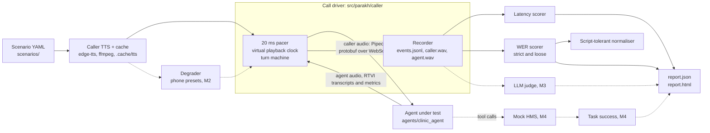

# Parakh

[](https://github.com/yatinannam/parakh/actions/workflows/ci.yml)
[](LICENSE)
[](.python-version)

A test harness for voice agents that serve Indian callers: Hinglish code-mixing, phone-quality audio and interruptions.

Voice agents built for Indian callers break in ways that generic tests do not show. Callers mix Hindi and English in one sentence, they call over narrowband phone lines, and they cut in. Generic scoring also misreports what does work: an agent whose speech-to-text writes a correct Hinglish turn in Devanagari gets a word error rate of 100 % against a Roman-script reference. Parakh plays a scripted synthetic caller to an agent in real time, records both directions, and measures response latency and script-tolerant recognition accuracy on the agent's own transcript. Telephone-line presets and interruptions come next (M2). It runs on a CPU-only laptop and uses free API tiers only.

## Results from the first run

One call to the Pipecat clinic test agent in this repository, scenario `clinic-book-hinglish-01`, preset `clean`. Run `6b5d9138` on 2026-11-17, Parakh `63add5c`.

| Metric | Value |
|---|---|
| Status | `completed`, exit code 0 |
| Caller turns | 4 of 4 played and answered |
| Response latency p50 / p95 | 4808 ms / 6769 ms |
| Strict WER (conversation) | 100.0 % |
| Loose WER (conversation, headline) | 16.7 % |
| Loose CER | 7.6 % |
| Caller send jitter p99 | 19.1 ms (limit 30 ms) |

These numbers come from one run of one scenario on a CPU-only laptop (Intel Core Ultra 5 225U, 16 GB RAM, Windows 11) against free tiers. The agent used Groq `whisper-large-v3-turbo` (language `hi`), Groq `openai/gpt-oss-20b` and edge-tts `en-IN-NeerjaNeural` on Pipecat 1.16.0; the caller voice was edge-tts `hi-IN-SwaraNeural`. They show what Parakh measures. They are not a benchmark of any provider. The agent's own time to first byte per Groq request was 0.1 to 0.6 s, while end-to-end latency per turn was 2.7 to 6.8 s, so most of the latency sat outside the Groq requests.

Strict WER is 100 % because the agent's Whisper writes Hinglish in Devanagari and the references are Roman. Loose WER recovers most of it. Turn 3 in `report.html`:

```
Turn 3  latency 3248 ms, strict WER 140.0%, loose WER 0.0%
Said: Haan, mera number hai nine eight four five, zero one two, three four five.
Reference: haan mera number hai 9845012345
Heard: हाँ, मेरा नमबर है 9845 012 345
Agent replied: आपका फोन नंबर 9845012345 है, सही है?
```

Under strict WER every Devanagari word misses its Roman reference, and Whisper wrote the phone number as three groups, so strict WER is 7 errors over 5 reference words. The normaliser turns the reference into `han mera number hai 9845012345` and the transcript into `han mera namabar hai 9845012345`; `number` and `namabar` match on their consonant skeleton `nmbr`, so loose WER is 0.

WER cannot see whether the call achieved its goal. The caller asked for half past ten ("saadhe das baje"); the agent booked 11:00 and, while reading the right phone number back to the caller, stored a different one (from the agent's tool-call log). The deterministic end-state check planned for M4 is built to catch this. The full run log is in the [M1 runbook](docs/runbooks/run-m1.md#the-first-real-run-turn-by-turn).

## Quick start

Prerequisites:

- Windows 10 or 11, or Linux. CI runs on `windows-latest` and `ubuntu-latest`.
- Python 3.11 (pinned in `.python-version`) and [uv](https://docs.astral.sh/uv/) 0.11 or later.
- ffmpeg on `PATH`. Parakh refuses to run without it.
- A free [Groq](https://console.groq.com/) API key for the test agent. No credit or debit card is needed anywhere in this project.

Install, including the test agent's dependency group:

```
git clone https://github.com/yatinannam/parakh.git
cd parakh
uv sync --all-groups
```

Put the key in `.env`, which is gitignored. Copy `.env.example` to `.env` (`cp .env.example .env`, or `Copy-Item .env.example .env` in PowerShell), set `GROQ_API_KEY`, then check it. The check only lists models and never prints the key ([API keys runbook](docs/runbooks/api-keys.md)).

```
uv run python -m tools.check_keys
```

Start the clinic test agent in one terminal. It checks the key and its configured Groq models, loads Silero VAD, and is ready when the log shows `Starting websocket server on 127.0.0.1:8765` and `pipeline is now ready` (about 10 s on the first start).

```
uv run --group agent python -m agents.clinic_agent --port 8765
```

Run the Hinglish scenario from a second terminal. The call takes about 70 s.

```
uv run parakh run scenarios/hinglish/clinic-book-hinglish-01.yaml --agent ws://127.0.0.1:8765 --preset clean
```

```
run dir: runs\6b5d9138
status: completed
latency p50/p95: 4808 / 6769 ms
loose WER: 16.7%
```

Open the report: `start runs\<id>\report.html` on Windows, `xdg-open runs/<id>/report.html` on Linux. The run directory also holds `report.json`, `events.jsonl` and the two audio tracks `caller.wav` and `agent.wav`, which start at the same instant. `runs/` is gitignored. The [M1 runbook](docs/runbooks/run-m1.md) covers the Groq budget, troubleshooting and how to read the report.

## CLI reference

| Command | What it does | Options |
|---|---|---|
| `parakh run SCENARIO --agent URL` | Synthesises the caller audio (cached), runs one real-time call, scores it, and writes `report.json` and `report.html` to a new run directory. | `--agent` ws:// or wss:// URL (required). `--preset` (default `clean`, the only preset in M1). `--runs-dir` (default `runs`). `--agent-rate` sample rate sent to the agent (default 16000). `--cache-dir` (default `.cache/tts`). |
| `parakh tts build PATH...` | Synthesises and caches the caller audio for scenario files or directories, and prints how many clips were built or cached. | `--cache-dir` (default `.cache/tts`). |
| `parakh report RUN_DIR` | Re-renders `report.html` from the run's `report.json`. | |
| `parakh budget PATH...` | Estimates Groq STT and LLM requests and audio seconds for scenario files or directories, against the free-tier limits. Exits 2 if over. | |
| `parakh version` | Prints the Parakh version. | |

The estimate counts one STT request per caller turn and one LLM request per agent reply. Real agents use more: the clinic agent's runs used 11 STT and 8 to 10 LLM requests against an estimate of 4 and 5, because its STT runs once per VAD segment and tool calls add LLM turns.

Exit codes of `parakh run`. Every status still writes `report.json` and `report.html`.

| Exit | Status |
|---|---|
| 0 | `completed`: every caller turn was played and answered, or the agent hung up after answering the last one. |
| 1 | `agent_hung_up_early`: the agent closed the socket before the first caller turn. |
| 2 | `turn_timeout`, `call_timeout`, `agent_disconnected`, `agent_unreachable`, `protocol_error`, `internal_error`, or any status when the caller could not keep its 20 ms pace (`timing_unreliable`). |
| 130 | `interrupted`: Ctrl+C during the run. The report is written first. |

Errors found before a call starts (unknown preset, a URL that is not ws:// or wss://, an invalid scenario, ffmpeg missing) print a message, write no run directory and exit 2. So do failures of `tts build` and an unreadable `report.json`.

## How the measurement works

**Real-time pacer.** For the whole call the caller sends one 20 ms frame every 20 ms: caller speech during a turn, silence between turns, as on a real line. The k-th frame targets `t0 + k * 20 ms` on `time.perf_counter_ns()`; a late tick sends at once and never shifts the schedule, because asyncio timers on Windows are about 15.6 ms coarse and relative sleeps drift. The lateness of every tick is recorded, and a run whose p99 lateness exceeds 30 ms is marked `timing_unreliable` and exits 2. The recorder writes `events.jsonl` from its own thread, so a stalled disk write cannot delay a frame.

**Virtual playback clock.** Agents often send speech faster than real time. Parakh models a phone speaker: each agent frame starts playing at the later of its arrival and the end of the previous frame, so `playback_end = max(playback_end, arrival) + duration`. "The agent is speaking" means the clock has not yet reached `playback_end`.

**Turn-taking.** With `agent_speaks_first`, the caller waits for the agent's greeting. The next caller turn starts once the agent is quiet on the playback clock and either it has sent RTVI `bot-stopped-speaking` or 800 ms of silence have passed since its audio ended. A caller-first scenario starts after 1000 ms with no agent audio. No agent audio within `response_timeout_s` (default 8 s) of a wait starting ends the call as `turn_timeout`; `call_timeout_s` (default 180 s) bounds the whole call. In M1 agent audio during a caller turn does not interrupt it; barge-in arrives in M2.

**Latency.** Per turn: the arrival time of the first agent audio frame above -45 dBFS after the caller's speech end and before the next caller turn, minus the caller's speech end. Speech end is the send time of the frame that holds the clip's `speech_end_ms` (measured on the clean clip at -45 dBFS), not the end of trailing silence. The report gives p50, p90, p95 and max, and lists the agent's own TTFB metrics per turn when it sends them.

**WER on the agent's own transcript.** Parakh scores what the agent heard: its final transcriptions of the caller (RTVI messages or Pipecat transcription frames), grouped into turns by time window. If the agent exposes no transcript, WER is null with a reason; Parakh never substitutes its own speech-to-text. Pipecat 1.16 sends each transcript twice (`user-input` and the deprecated `user-transcription`) and repeats bot output segments; Parakh records each once and logs the repeat as an `rtvi_repeat` event. The headline is conversation-level loose WER over all turns, so a VAD that splits or merges turns does not distort it; per-turn WER is a diagnostic.

- **Strict WER**: jiwer on NFC text, lowercased, punctuation stripped.
- **Loose WER**: Parakh's own Levenshtein over normalised tokens. Two tokens match when their loose keys are equal, or, for words, when their consonant skeletons are equal (three or more consonants) and their lengths differ by at most 2. Numbers must match exactly. **Loose CER** is the same over the characters of the normalised text.

**Script-tolerant normaliser**, applied to reference and hypothesis alike, in this order:

1. Unicode NFC; remove zero-width joiners and non-joiners; flag Perso-Arabic script as `script_unsupported`.
2. Devanagari to Roman with `indic-transliteration` (ITRANS), word by word. Candra o (`ॉ`, `ऑ`) is read as `ो`, `ओ` first, so `डॉक्टर` gives `doktar`. Anusvara and chandrabindu become `n`, or `m` before p, b and m, so `मैं` gives `main`. The inherent final schwa is dropped when ITRANS ends a word in a short `a` after a consonant, so `कल` gives `kal`.
3. Lowercase, keep only `a-z` and `0-9`, split into tokens.
4. Number words to digits: English words up to ninety-nine, "X hundred [and] Y", "double" and "triple", and Hindi words for 0 to 10; then adjacent digit tokens are joined, so a phone number in groups becomes one token.
5. Loose phonetic key for words: `c` (not before h) to `k`, `ph` to `f`, `w` to `v`, `q` to `k`, `z` to `j`, final `ov` to `o`, `ee` to `i`, `oo` to `u`, double letters to single (`aa` to `a`), `y` between vowels dropped; then a small variant table (`nahin` and `nai` to `nahi`, `men` and `me` to `mein`, `rav` to `rao`). Ambiguous pairs such as `main` and `mein` stay distinct.

Two worked examples, both checked against the current code:

| Input | Steps | Tokens |
|---|---|---|
| `हाँ` (Whisper) | ITRANS `hA.N`; chandrabindu to `n`: `hAn`; lowercase | `han` |
| `haan` (reference) | double `aa` to `a` | `han` |
| `nine eight four five, zero one two, three four five` (reference) | number words to digits, then joined | `9845012345` |
| `9845 012 345` (Whisper) | adjacent digit groups joined | `9845012345` |

The normaliser has a golden file of pairs that must match and pairs that must not ([`tests/golden/normalizer_pairs.yaml`](tests/golden/normalizer_pairs.yaml)). Spec [section 6.7](docs/superpowers/specs/2026-11-15-parakh-design.md#67-scoring) gives the full rules.

## Architecture



Dashed parts are planned. The agent runs as a separate process. Scoring runs after the call ends, so local models never compete with the live call for CPU. Because the transport is Pipecat's standard protobuf frame protocol, Parakh tests an unmodified Pipecat agent. The [knowledge graph](docs/kg/README.md) maps every component, decision, risk and document; the [design spec](docs/superpowers/specs/2026-11-15-parakh-design.md) has the details.

## Scenario format

A scenario is a YAML file validated by pydantic. This is the M1 scenario, [`scenarios/hinglish/clinic-book-hinglish-01.yaml`](scenarios/hinglish/clinic-book-hinglish-01.yaml):

```yaml
schema_version: 1
id: clinic-book-hinglish-01
title: Book a follow-up with Dr. Rao (Hinglish)
language: hi-en
domain: clinic
clock: "2026-11-19T10:00:00+05:30"
agent_speaks_first: true
caller:
  voice: hi-IN-SwaraNeural
  rate: "+0%"
turns:
  - say: "Hello, mujhe Dr. Rao ke saath follow-up appointment chahiye."
    ref: "hello mujhe doctor rao ke saath follow up appointment chahiye"
  - say: "Kal subah, agar possible ho toh saadhe das baje."
  - say: "Haan, mera number hai nine eight four five, zero one two, three four five."
    ref: "haan mera number hai 9845012345"
  - say: "Haan, sahi hai. Thank you, bye."
limits: { max_turns: 12, response_timeout_s: 8, call_timeout_s: 180 }
```

| Field | Meaning |
|---|---|
| `say` | Text the caller's TTS speaks, in the script the voice reads best. |
| `ref` | Reference transcript for WER. Defaults to `say`. |
| `clock` | Frozen "now" for the scenario, with a timezone offset. In M1 the clinic agent reads the same value from its own `config.yaml`. |
| `agent_speaks_first` | Wait for the agent's greeting (default `true`), or speak after 1 s of silence. |
| `caller` | edge-tts voice, rate and pitch. |
| `limits` | `max_turns`, `response_timeout_s`, `call_timeout_s`. |

The schema also accepts `barge_in` per turn (M2) and `hms_seed` and `expect` (M4). All scenario content is synthetic: invented names, numbers and clinics.

## Status

| Milestone | Scope | State |
|---|---|---|
| M0 | Repository hygiene, CI, tooling, Task 1 evaluation of Calibrate | Complete (2026-11-16) |
| M1 | One Hinglish scenario, clean audio, Pipecat clinic test agent, latency and strict and loose WER, JSON and HTML report | Complete (2026-11-17) |
| M2 | Degradation presets (telephone band, 8 kHz, G.711 mu-law, noise, packet loss) and barge-in with stop latency | Planned |
| M3 | Normaliser hardened on 150 or more golden pairs, 10-20 Hinglish scenarios, LLM judge; then Kannada-English and Tamil-English | Planned |
| M4 | Mock hospital management system and end-state adapter for deterministic task success; end-to-end CI workflow | Planned |
| M5 | Public release: scenario pack, comparison run across presets and agent setups | Planned |

## Repository layout

```
src/parakh/
  scenario/            Scenario model and YAML loader
  tts/                 edge-tts caller audio, ffmpeg decoding, content-addressed cache
  caller/              Call driver: pacer, playback clock, turn machine, recorder
  transport/           Pipecat protobuf codec, RTVI parsing, WebSocket connection
  score/               Latency, script-tolerant normaliser, strict and loose WER
  report/              report.json model and the self-contained report.html
  budget/              Groq usage estimate and the remote_call() guard
  audio.py             WAV, dBFS, resampling, framing, silence trim
  run.py               One scored run and its exit code
  cli.py               Command-line interface
agents/clinic_agent/   Pipecat test agent: Silero VAD, Groq STT and LLM, edge-tts
scenarios/hinglish/    Scenario files
tests/unit/            Unit tests; no network, no keys
tests/integration/     Real-time calls against an in-process fake Pipecat agent
tests/golden/          Normaliser pairs that must and must not match
tools/                 no_emoji, kg_render, check_keys; calibrate_eval (WSL only)
docs/                  Spec, plans, research, runbooks, reviews, knowledge graph
.github/               CI workflow and Dependabot config
```

## Development

```
uv sync --all-groups
uv run pre-commit install
uv run pytest -q
```

| Check | Command | Pre-commit | CI |
|---|---|---|---|
| Lint | `uv run ruff check .` | yes (with `--fix`) | yes |
| Format | `uv run ruff format --check .` | yes (formats) | yes |
| Types | `uv run pyright` | no | yes |
| Tests | `uv run pytest -q` | no | yes |
| No emoji in tracked files | `uv run python -m tools.no_emoji` | yes | yes |
| Knowledge-graph views in sync | `uv run python -m tools.kg_render --check` | yes | yes |
| Secret scan | gitleaks | yes | yes (full history) |
| YAML, TOML, whitespace, large files | pre-commit-hooks | yes | no |

CI runs on Ubuntu and Windows and installs ffmpeg. Unit and integration tests need no network and no API keys. GitHub Actions and pre-commit hooks are pinned to full commit SHAs, and a unit test fails on any unpinned one.

## Documentation

| Document | Contents |
|---|---|
| [docs/README.md](docs/README.md) | Index of all project documentation. |
| [Design spec](docs/superpowers/specs/2026-11-15-parakh-design.md) | Goals, architecture, components, testing, CI, milestones, edge-case register, decisions. |
| [M1 runbook](docs/runbooks/run-m1.md) | Running the agent and the scenario, reading the report, troubleshooting, the run log. |
| [Calibrate analysis](docs/research/2026-11-15-calibrate-analysis.md) | Task 1: what Calibrate covers and lacks, the free-model run, and the verdict. |
| [`pipecat.evals` note](docs/research/2026-11-16-pipecat-evals-note.md) | What Pipecat's eval harness does and needs, and decision D14. |
| [Knowledge graph](docs/kg/README.md) | `graph.yaml` plus generated Mermaid views of the pipeline, governance and milestones. |

## Constraints

- **Free tiers only.** Groq and Gemini free tiers; OpenRouter `:free` models only for the Calibrate comparison. Any step that asks for a card is out of scope.
- **Synthetic data only to hosted APIs.** Some free tiers may train on inputs. Scenarios, caller scripts and patient records are synthetic. Real recordings (a person reading synthetic scripts) stay on the local machine under `data/real/`, which is gitignored.
- **No secrets in git.** `.env` is gitignored, gitleaks runs in pre-commit and CI, and GitHub push protection is on. Agent URLs are stripped of credentials, query and fragment wherever Parakh stores or prints them.
- **CPU only.** Local models run on CPU and never at the same time.
- **No emoji** in any tracked file, enforced by `tools/no_emoji.py`.

## Relationship to Calibrate

[Calibrate](https://github.com/ARTPARK-SAHAI-ORG/calibrate) (ARTPARK-SAHAI) is a Pipecat-based evaluation framework for text and voice agents. Task 1 reviewed its source and ran one of its text simulations on free models. It covers persona simulation, interruptions and mean latency. It does not cover telephone-channel degradation, script-tolerant code-mixed scoring for external agents, deterministic task success, latency distributions, or a voice path that runs on free tiers. Parakh is therefore a standalone tool that stays protocol-compatible with Calibrate ([analysis](docs/research/2026-11-15-calibrate-analysis.md)). This is a clean-room relationship: Calibrate is licensed CC-BY-SA-4.0, and no Calibrate code is copied into this repository. `tools/calibrate_eval/` contains only MIT code that imports a separately installed copy of `calibrate-agent` inside WSL, for the comparison run.

## Relationship to `pipecat.evals`

Pipecat 1.16 added `pipecat.evals`: scripted and simulated scenarios, a cached TTS user, an LLM judge, a suite runner, 40 ms paced user audio and `within_ms` latency budgets. It needs the bot to run Pipecat's eval transport and `EvalSerializer`, and it has no telephone degradation, no script-tolerant WER and no latency distributions. Parakh keeps its own call driver, which tests unmodified agents that serve Pipecat's standard protobuf serializer (decision D14). The two are complementary: `pipecat.evals` for behavioural checks, Parakh for the audio channel and Hinglish recognition ([note](docs/research/2026-11-16-pipecat-evals-note.md)).

## Contributing

Read [CONTRIBUTING.md](CONTRIBUTING.md) first: it has the Calibrate clean-room rule, the hard constraints and the test-first workflow.

## Licence

MIT. See [LICENSE](LICENSE).
