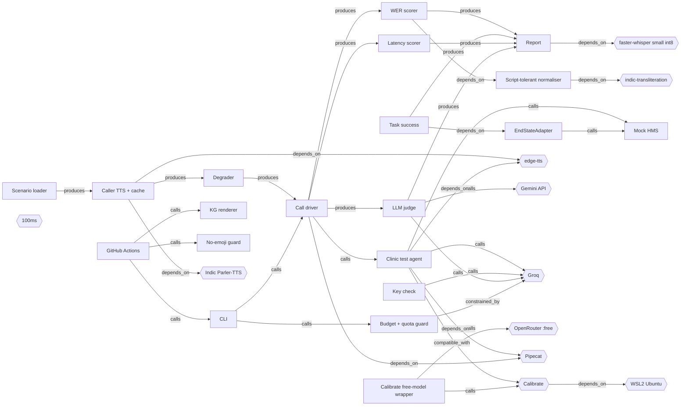
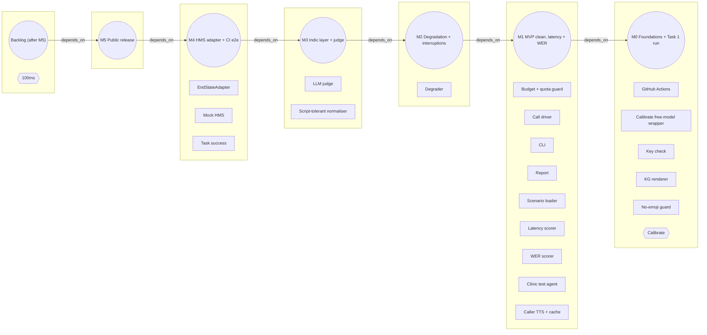

# Parakh knowledge graph

Source of truth: [`graph.yaml`](graph.yaml). The diagrams below are generated from it by `python -m tools.kg_render`; do not edit them by hand. CI and pre-commit run `python -m tools.kg_render --check` and fail when they are out of date.

Node types and shapes:

| Type | Meaning | Shape |
|---|---|---|
| component | Code in this repo | rectangle |
| external | Third-party service, library or tool | hexagon |
| constraint | Hard rule from CLAUDE.md or the spec | stadium |
| decision | Recorded design decision (D-numbers in the spec) | parallelogram |
| risk | Edge-case group (EC-numbers in the spec) | flag |
| doc | Document in `docs/` | cylinder |
| milestone | Build milestone | circle |

## Pipeline and dependencies

Components and externals, with the edges between them.

<!-- kg:begin pipeline -->

<!-- kg:end pipeline -->

## Constraints, decisions and risks

Every edge that touches a constraint, decision or risk.

```mermaid
flowchart TB
  budget["Budget + quota guard"]
  c_cpu(["CPU only, 16 GB"])
  c_free(["Free only, no card"])
  c_mit(["MIT, no Calibrate code"])
  c_secrets(["No secrets in git"])
  c_synthetic(["Synthetic data to free LLM APIs"])
  c_windows(["Windows dev box"])
  call_driver["Call driver"]
  ci["GitHub Actions"]
  d1[/"D1 Standalone, Pipecat-compatible"/]
  d10[/"D10 Real recordings stay local"/]
  d11[/"D11 Headline = conversation loose WER"/]
  d12[/"D12 Audience: portfolio first"/]
  d2[/"D2 Calibrate text sim in WSL"/]
  d3[/"D3 HMS = hospital mgmt system"/]
  d4[/"D4 Scripted caller"/]
  d5[/"D5 Test agent stack"/]
  d6[/"D6 Judge Groq then Gemini"/]
  d8[/"D8 KG as YAML + Mermaid"/]
  d9[/"D9 Pack ships text, not edge-tts audio"/]
  doc_calibrate[("Calibrate analysis")]
  doc_spec[("Design spec")]
  judge["LLM judge"]
  mock_hms["Mock HMS"]
  normalizer["Script-tolerant normaliser"]
  r_alignment>"Turn alignment"]
  r_injection>"Judge prompt injection"]
  r_license>"Licence contamination"]
  r_llm_behaviour>"Hosted LLM behaviour"]
  r_privacy>"Real data leakage"]
  r_quota>"Free-tier quota"]
  r_script>"Script/spelling mismatch"]
  r_supply_chain>"Supply chain (CI and hooks)"]
  r_timing>"Timing accuracy"]
  r_windows_install>"Windows install gaps"]
  report["Report"]
  scenario["Scenario loader"]
  score_wer["WER scorer"]
  t_calibrate_eval["Calibrate free-model wrapper"]
  t_check_keys["Key check"]
  t_kg_render["KG renderer"]
  test_agent["Clinic test agent"]
  tts_cache["Caller TTS + cache"]
  x_calibrate{{"Calibrate"}}
  x_parler{{"Indic Parler-TTS"}}
  x_whisper{{"faster-whisper small int8"}}
  x_wsl{{"WSL2 Ubuntu"}}
  budget -->|constrained_by| c_free
  budget -->|constrained_by| c_synthetic
  budget -->|decided_by| d10
  budget -->|mitigates| r_quota
  call_driver -->|constrained_by| c_windows
  call_driver -->|decided_by| d1
  call_driver -->|mitigates| r_timing
  ci -->|constrained_by| c_secrets
  ci -->|decided_by| d12
  ci -->|mitigates| r_supply_chain
  d1 -->|documented_in| doc_spec
  d10 -->|mitigates| r_privacy
  d9 -->|mitigates| r_license
  judge -->|constrained_by| c_synthetic
  judge -->|decided_by| d6
  judge -->|mitigates| r_injection
  mock_hms -->|decided_by| d3
  normalizer -->|mitigates| r_script
  r_llm_behaviour -->|documented_in| doc_calibrate
  report -->|mitigates| r_llm_behaviour
  scenario -->|decided_by| d4
  score_wer -->|decided_by| d11
  score_wer -->|mitigates| r_alignment
  t_calibrate_eval -->|constrained_by| c_free
  t_calibrate_eval -->|constrained_by| c_synthetic
  t_calibrate_eval -->|decided_by| d2
  t_check_keys -->|constrained_by| c_secrets
  t_kg_render -->|decided_by| d8
  test_agent -->|decided_by| d5
  test_agent -->|mitigates| r_llm_behaviour
  tts_cache -->|decided_by| d9
  x_calibrate -->|constrained_by| c_mit
  x_calibrate -->|decided_by| d2
  x_parler -->|constrained_by| c_cpu
  x_whisper -->|constrained_by| c_cpu
  x_wsl -->|mitigates| r_windows_install
```

<!-- kg:begin governance -->

<!-- kg:end governance -->

## Milestones

What each milestone delivers.

<!-- kg:begin milestones -->

<!-- kg:end milestones -->

## How to update

1. Add or change nodes and edges in `graph.yaml`. Every new component, decision or risk gets a node.
2. Run `uv run python -m tools.kg_render`.
3. Commit `graph.yaml` and `README.md` together.
