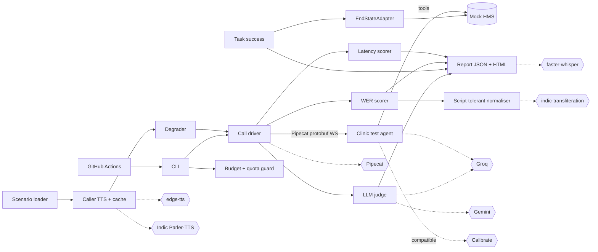
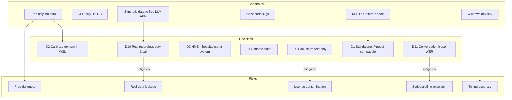
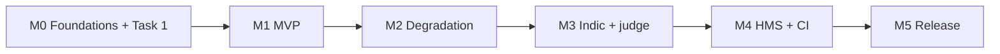

# Parakh knowledge graph

Source of truth: [`graph.yaml`](graph.yaml). These diagrams are views of it. Until the render script lands (M0), keep them in sync by hand.

Node types: constraint, component, external, decision, risk, doc, milestone.

## Pipeline and dependencies

## Constraints, decisions and risks

## Milestones

## How to update

1. Add or change nodes and edges in `graph.yaml`. Give every new component, decision or risk a node.
2. Update the diagrams above (later: `python scripts/kg_render.py`).
3. Commit both files together.
